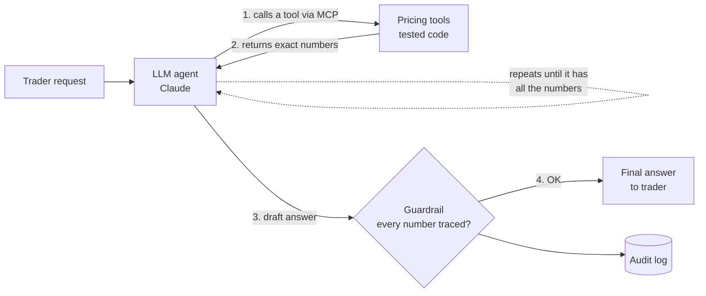
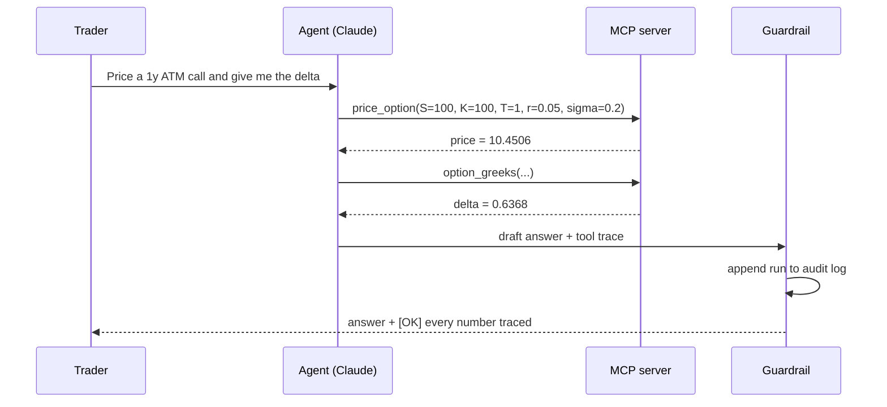

# Quant Agent MCP

Agentic quant assistant: an MCP server exposes deterministic pricing tools
(Black-Scholes, Greeks, implied volatility, yield curve) and an agent answers
trader requests. Every number is computed by a tool, validated and logged.

## Architecture

### Request flow

## Quickstart

## Evaluation
