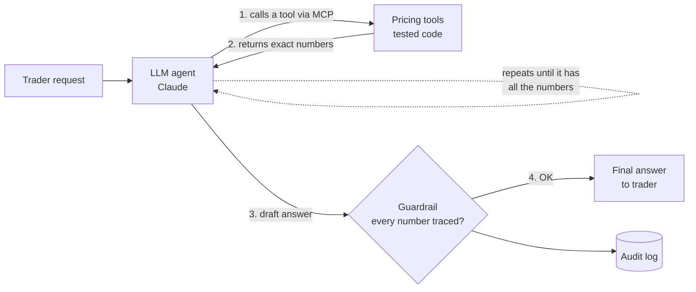
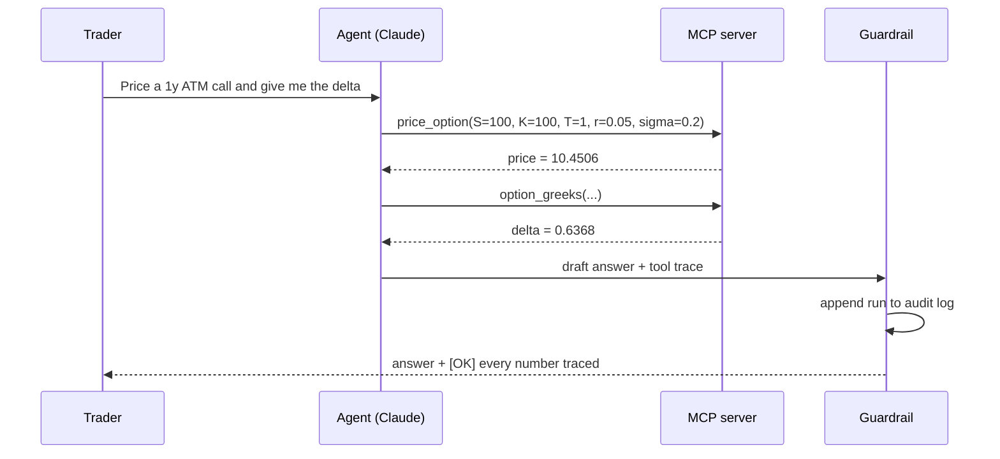

# Quant Agent MCP


Agentic quant assistant: an MCP server exposes deterministic pricing tools
(Black-Scholes, Greeks, implied volatility, yield curve) and an agent answers
trader requests. Every number is computed by a tool, validated and logged.

> **Why it matters:** LLMs are good at understanding requests but can produce plausible wrong
> numbers. On a trading desk a wrong price is costly. This project keeps the LLM for language
> and delegates all computation to validated code, with guardrails and evaluations on top.

## Demo

```text
$ quant-agent "Price a 1-year at-the-money call, spot 100, volatility 20%, rate 5%, and give me the delta"

European call (Black-Scholes-Merton)
Inputs: S = 100, K = 100, T = 1 year, r = 0.05, sigma = 0.20, dividend yield q = 0 (tool default).

- Price: 10.4506
- Delta: 0.6368

[OK] Every number is traced to a tool result or the request.
[2 tool call(s) | audit log: logs/audit.jsonl]
```

## Architecture

The system separates **language understanding** from **computation**. The LLM reads the
trader's request and decides which tool to call, but it never computes a number itself.
Every figure comes from a deterministic, unit-tested pricing library exposed through an
MCP server, and every answer is checked before it reaches the trader.



### Request flow

The sequence below shows a real request: one price and one Greek, so two tool calls.



If an input is missing (for example the volatility), the agent asks for it instead of
assuming a value. If a request is invalid, the tool rejects it and the agent explains why.

## Evaluation

The agent is evaluated on 13 representative trader requests across 5 categories:
pricing, Greeks, implied volatility, rates, and safety (a missing input the agent must ask for,
and invalid requests it must refuse). Expected values are computed by the pricing code itself,
never hard-coded. Each case is run 3 times to measure consistency, as LLM outputs vary between runs.

The report follows a model-validation layout: summary metrics, results by category and case
details. See [`evals/results.md`](evals/results.md) for the latest run.

**What the first run taught me.** The first run scored 10/13. Analysing the failures showed:

- 2 failures came from the **grader**: it did not recognise the Unicode minus sign (`−0.5609`)
  and read numbered-list markers (`1.`, `2.`) as numbers.
- 1 failure was a real **agent behaviour**: when an input was missing, it suggested an example
  volatility. On a trading desk this can bias a trader, so the prompt now forbids suggesting values.

Both were fixed and covered by regression tests.

## Quickstart

```bash
git clone https://github.com/Esma-EL/quant-agent-mcp.git
cd quant-agent-mcp
python -m venv .venv
# Windows: .venv\Scripts\Activate.ps1   |   macOS/Linux: source .venv/bin/activate
pip install -e ".[dev]"
```

Set your Anthropic API key as an environment variable (never in the code):

```bash
# Windows
setx ANTHROPIC_API_KEY "your-key"
# macOS/Linux
export ANTHROPIC_API_KEY="your-key"
```

| Command | What it does |
|---|---|
| `quant-agent "your request"` | Ask the agent a question |
| `quant-agent-eval` | Run the evaluation suite and write `evals/results.md` |
| `quant-agent-mcp` | Start the MCP server over stdio, for any MCP client |
| `pytest` | Run the unit tests (no API key needed: the agent tests use a fake LLM) |
| `ruff check .` | Lint |

## Project structure

| File | Role |
|---|---|
| `pricing.py` | Black-Scholes-Merton prices, analytical Greeks, implied volatility (Brent), input validation and no-arbitrage bounds |
| `rates.py` | Discount curve bootstrapped from annual par swap rates, zero and forward rates |
| `server.py` | MCP server exposing 4 tools: `price_option`, `option_greeks`, `implied_volatility`, `yield_curve` |
| `agent.py` | Tool-calling loop with Claude over the MCP protocol, with a step limit and error propagation |
| `guardrails.py` | Flags any number in the answer that does not come from the request or a tool, writes the audit log |
| `evals.py` | Evaluation harness with automated scoring and a model-validation style report |

## Engineering practices

- **Tests:** reference values, put-call parity, Greeks checked against finite differences,
  implied-vol round trips, curve repricing of the input swaps, invalid inputs.
- **CI:** GitHub Actions runs ruff and pytest on Python 3.11 and 3.12 for every push.
- **Dependencies:** major versions pinned where an upgrade already broke the code
  (`mcp>=2,<3`); Dependabot proposes updates that CI tests automatically.
- **Security:** API key read from the environment only; audit logs and secrets are git-ignored.

## Limitations and next steps

- European options under Black-Scholes-Merton only (no American exercise, no volatility smile).
- The yield curve takes consecutive annual par rates; no day-count conventions or calendars.
- The guardrail checks the **provenance** of numbers, not their meaning: a correct number
  attached to the wrong label would pass. The evaluation suite partly covers this gap.
- 13 evaluation cases is a starting point and should be extended.

## Tech stack

Python, NumPy, SciPy, MCP Python SDK (v2), Anthropic API, pytest, ruff, GitHub Actions.